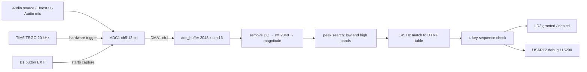
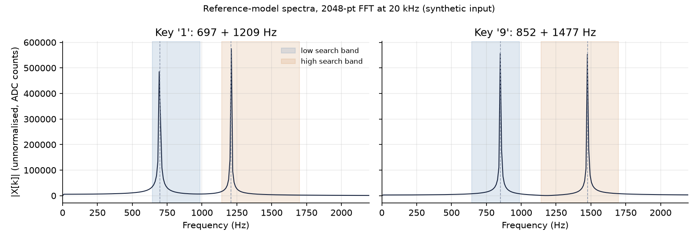
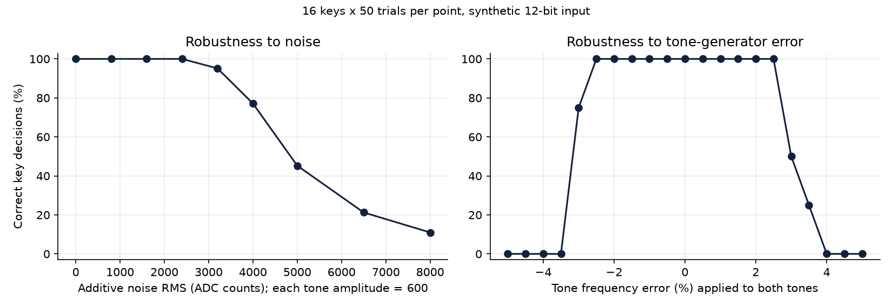

# Real-Time DTMF Tone Detector on an STM32 (Cortex-M4F)

A bare-metal firmware project that samples audio at 20 kHz with a timer-triggered, DMA-driven ADC, runs a 2048-point real FFT (CMSIS-DSP), identifies Dual-Tone Multi-Frequency (DTMF) keypad tones, and checks a four-digit passcode. A host-side Python model of the same algorithm provides automated tests and robustness figures.

Course project for CPE 3500 (Embedded Digital Signal Processing), Kennesaw State University, Spring 2026. Solo work.

## Engineering problem

DTMF keys are pairs of sine tones, one from a low group (697–941 Hz) and one from a high group (1209–1633 Hz). Detecting them on a microcontroller means acquiring audio at a fixed sample rate with no CPU involvement, converting it to the frequency domain fast enough to be useful, and making a reliable accept/reject decision despite leakage, DC offset and imperfect tone sources.

## Objectives

- Fixed-rate acquisition with no software jitter: TIM6 hardware trigger → ADC → DMA.
- Frequency-domain detection with CMSIS-DSP on the Cortex-M4F FPU.
- A clear rejection path for weak, single-tone and out-of-band signals.
- A testable algorithm, so behaviour can be checked without the board.

## System overview



| Item | Value (from `firmware/Core/Src/main.c` and `Project.ioc`) |
|---|---|
| MCU / board | STM32L476RG, Nucleo-L476RG |
| System clock | HSI 16 MHz → PLL ×10 → 80 MHz |
| Sample trigger | TIM6, prescaler 79, period 49 → 20 kHz TRGO |
| ADC | ADC1 channel 5, 12-bit, 2.5-cycle sampling, rising-edge external trigger, DMA |
| Capture window | 2048 samples = 102.4 ms |
| FFT | `arm_rfft_fast_f32`, N = 2048, 9.766 Hz per bin |
| Search bands | low bins 66–101 (≈645–986 Hz), high bins 117–174 (≈1143–1699 Hz) |
| Decision | peak bin × 9.766 Hz within ±45 Hz of a nominal tone; both peaks must exceed `MAG_THRESHOLD` (60) |
| Passcode | 4 keys, compile-time constant in `main.c` |
| Feedback | LD2 solid 2 s when granted; 10 toggles at 100 ms when denied; USART2 log |

## Algorithm

For a capture `x[n]`, n = 0…2047:

1. `x'[n] = x[n] − mean(x)` removes the ADC bias.
2. `X[k] = rfft(x')`, and `|X[k]|` is the magnitude (bin 0 zeroed).
3. `k_low = argmax |X[k]|` over the low band, `k_high` likewise over the high band; `f = k · Fs / N`.
4. Reject if either peak magnitude is below `MAG_THRESHOLD`.
5. Find the row `i` with `|f_low − low[i]| ≤ 45 Hz` and the column `j` with `|f_high − high[j]| ≤ 45 Hz`. Reject if either is missing; otherwise the key is `keypad[i][j]`.

The frequency resolution is Fs/N = 9.766 Hz, so the worst-case quantisation error of a peak is about 4.9 Hz, well inside the ±45 Hz tolerance.

## Repository layout

```
firmware/
  Core/Src, Core/Inc     application and CubeMX-generated sources
  Project.ioc            CubeMX configuration (regenerates Drivers/)
  STM32L476RGTX_*.ld     linker scripts
tools/
  dtmf_reference.py      host-side model of processFFT()
  make_figures.py        regenerates results/
tests/test_dtmf_reference.py
results/                 figures + summary.json (synthetic input)
```

Vendor HAL/CMSIS drivers and build output are intentionally not committed. They are regenerated by CubeMX.

## Build and run

### Firmware

1. Install STM32CubeIDE (the original project used 1.19.0).
2. Create a new STM32 project from `firmware/Project.ioc` (or import the folder), let CubeMX generate `Drivers/`, and make sure CMSIS-DSP is enabled and `ARM_MATH_CM4` / `__FPU_PRESENT=1` are defined.
3. Build and flash a Nucleo-L476RG. Open the ST-Link virtual COM port at 115200 baud.
4. Play a DTMF tone near the microphone input and press B1 once per digit.

### Host-side model and tests

```bash
python -m venv .venv && source .venv/bin/activate
pip install -r requirements.txt
pytest -q
python tools/make_figures.py
```

## Results

All results below come from the host-side model with **synthetic input**. They characterise the algorithm and its parameters. They are not measurements from the board.

**Tests.** 38 tests pass: all 16 keys decode on clean input and with ±1 % frequency error, silence, a single tone and an out-of-band pair are rejected, and the example passcode sequence is accepted/rejected correctly.





Sweep results (16 keys × 50 trials per point, each tone amplitude 600 counts, 12-bit clipping applied):

| Additive noise RMS (counts) | 0 | 800 | 1600 | 2400 | 3200 | 4000 | 5000 | 6500 | 8000 |
|---|---|---|---|---|---|---|---|---|---|
| Correct key (%) | 100 | 100 | 100 | 100 | 95.1 | 77.1 | 45.2 | 21.2 | 11.0 |

At the highest noise levels the combined signal is clipping against the ADC rails, so those points show a degenerate operating condition, not a clean SNR curve.

Tone-frequency error: 100 % correct from −2.5 % to +2.5 %; it falls to 75 % at −3 % and 50 % at +3 %. The cutoff comes from the fixed ±45 Hz tolerance: the highest tone (1633 Hz) shifts by more than 45 Hz at about 2.8 %. A tolerance proportional to frequency would extend the window evenly across tones.

## Hardware validation

Not documented yet. A photo of the Nucleo + BoostXL-Audio setup and a captured UART log of a granted and a denied sequence would complete this section. None are included, and none have been fabricated.

## Engineering notes and limitations

- No window function is applied before the FFT. With 9.77 Hz bins, non-bin-centred tones leak, but the peaks stay well separated, which is why detection still works. A Hann window would reduce leakage if the bands were tightened.
- `MAG_THRESHOLD = 60` is on an unnormalised FFT: a sine of amplitude A gives about 1024·A, so 60 corresponds to roughly 0.06 counts of amplitude. It acts as a guard against an all-zero capture, not as a practical SNR gate. A threshold relative to the band's noise floor, or a ratio test between the two peaks, would be stronger.
- Detection is one capture per button press (102.4 ms), not continuous. Feedback uses blocking `HAL_Delay`.
- The start-up banner prints `Passcode: 6`, which does not match the compiled passcode and also discloses it. Remove it before any real use.
- The passcode is a compile-time constant. This is a coursework demo, not an access-control product.
- FFT execution time on the target was not measured, so the project makes no latency claim beyond the 102.4 ms capture window.

## Lessons learned

- Hardware-triggered ADC + DMA removes sample-rate jitter that would otherwise spoil FFT results.
- Choosing N and Fs so that bin width (9.77 Hz) is much smaller than the tone spacing (≥ 73 Hz) makes a simple peak search sufficient.
- Modelling the algorithm on a host made the tolerance and threshold behaviour inspectable, and exposed the fixed-Hz tolerance limit above.

## Future work

- Windowed FFT or Goertzel filters for the 8 DTMF frequencies (cheaper than a full FFT).
- Relative threshold, twist and ratio tests, and continuous detection with debounce between tones.
- Measure FFT time with the DWT cycle counter and log it.
- Move the passcode and feedback to a non-blocking state machine.

## Preparation note

The firmware (`firmware/`) is the author's own coursework. The host-side model, tests, figures and this README were produced during portfolio preparation with AI assistance (Claude).

## License

MIT for the original code in `firmware/Core/Src/main.c`, `tools/`, `tests/`. STM32Cube-generated files carry STMicroelectronics' own license headers.
